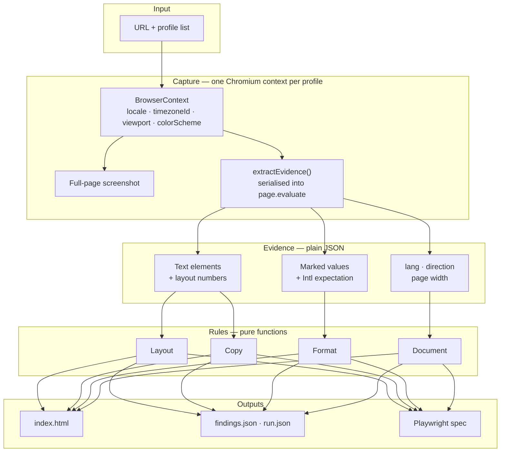
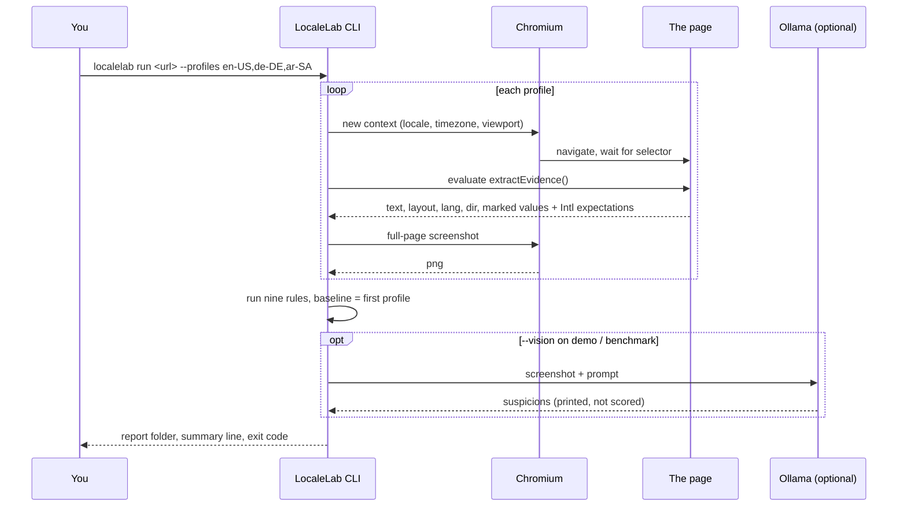

# LocaleLab

<p align="center">
  <a href="LocaleLab%20Demo.mp4">
    
  </a>
  <br>
  <sub>▶ <b><a href="LocaleLab%20Demo.mp4">Watch the LocaleLab demo</a></b> (90 s): the bundled storefront in en-US, de-DE, ja-JP and ar-SA with every planted defect it catches, the offline report, the benchmark and the generated Playwright spec, a run on a real page, and the CI run that is still red</sub>
</p>

**Localization QA in the browser — a CLI that opens one URL in several locale, timezone and text-direction "realities", runs deterministic checks over what Chromium actually rendered, and shows you the evidence for every finding.**

[](.github/workflows/ci.yml)
[](package.json)
[](tsconfig.json)
[](package.json)
[](docs/rules.md)
[](#project-status)
[](LICENSE)

You shipped the German build and someone in Berlin sends a screenshot: the sale
date reads `Nov 11, 2026`, the free-shipping badge is cut off mid-word, and the
checkout button says `checkout.cta.label`. None of that showed up in review
because everyone reviewed in `en-US`. LocaleLab does the switching for you: it
opens the page as a German, Japanese and Arabic browser would, screenshots each
one, and reports what is wrong for that locale.

Every finding carries the numbers or strings it was based on, so when LocaleLab
says a date is wrong you can see the browser's own `Intl` output next to what
the page showed.

```
$ localelab run https://shop.example --profiles en-US,de-DE,ja-JP,ar-SA

Capturing US English (en-US, America/New_York)
  ok en-US: 36 text elements, 7 marked values, 837 ms
Capturing German (de-DE, Europe/Berlin)
  ok de-DE: 36 text elements, 7 marked values, 832 ms
...
  error   de-DE  format-date       Date rendered as "Nov 11, 2026" but the browser locale formats it as "11.11.2026".
  error   de-DE  text-clipping     "Kostenloser Versand ab 50 $ Bestellwert" is clipped horizontally by 89 px.
  error   ar-SA  untranslated-text "Sign in" is marked for translation but matches the en-US baseline.
16 findings (16 errors, 0 warnings, 0 info). Report: localelab-report/index.html
```

---

## Contents

| Section | |
|---|---|
| [What it does](#what-it-does) | The capability surface, by area |
| [Architecture](#architecture) | Profile, capture, evidence, rules, outputs |
| [How a page travels](#how-a-page-travels) | From a URL to a report |
| [Quick start](#quick-start) | Install, demo, first run |
| [Commands and settings](#commands-and-settings) | Flags, markers, exit codes |
| [Project status](#project-status) | What is built, and what CI proves |
| [Design decisions](#design-decisions) | The tradeoffs, and why |
| [Repository layout](#repository-layout) | Where things live |
| [Documentation](#documentation) | Which file answers which question |
| [Author](#author) | Who built it |

---

## What it does

| Area | Capabilities |
|---|---|
| **Profiles** | Eight built-in realities (`en-US`, `en-GB`, `de-DE`, `fr-FR`, `ja-JP`, `ar-SA`, `hi-IN`, `es-ES`) and ad-hoc ones written as `<locale>@<IANA timezone>`; each is a real Chromium context with `locale`, `timezoneId`, viewport and colour scheme set |
| **Capture** | Full-page screenshot per profile plus one in-page extraction pass that returns plain JSON: text elements with layout numbers, `lang`, resolved direction, page width, marker attributes |
| **Layout rules** | Horizontal page overflow; text clipped by `overflow: hidden` or `text-overflow: ellipsis`, measured from `scrollWidth` against `clientWidth` |
| **Copy rules** | Leaked placeholders (`{{name}}`, `%s`, ICU `{count, plural, ...}`), raw translation keys, `TODO` and lorem ipsum, "missing translation" markers; text that is identical to the baseline in a profile with another language |
| **Format rules** | Marked dates, numbers and currency amounts compared with what the page's own `Intl` produces for that locale and timezone, using the same CLDR data the browser ships |
| **Document rules** | `<html lang>` disagreeing with the profile; a right-to-left profile rendered left-to-right |
| **Outputs** | Offline HTML report with screenshots and evidence tables, `findings.json`, `run.json`, and a generated Playwright spec that re-asserts the observed facts |
| **Benchmark** | A bundled storefront with six planted defects and a 16-observation truth matrix, scored for precision and recall on every CI run |
| **Vision (optional)** | A local Ollama vision model looks at the screenshots and prints suspicions; advisory only, never scored |

### The nine rules

| Rule | Severity | What it means |
| :-- | :-- | :-- |
| `page-horizontal-overflow` | warning | The page is wider than the viewport |
| `text-clipping` | warning, error if marked for translation | An element hides its own overflowing text |
| `unresolved-copy` | error (warning for TODO and lorem ipsum) | A placeholder, raw key or missing-translation marker is visible |
| `untranslated-text` | error for marked text, warning for the heuristic | Text matches the baseline in a profile with another language |
| `format-date` | error | A marked date does not match `Intl.DateTimeFormat` for that locale and timezone |
| `format-number` | error | Same for numbers |
| `format-currency` | error | Same for currency amounts |
| `document-language-mismatch` | warning, info if `lang` is missing | `<html lang>` disagrees with the profile |
| `rtl-direction-missing` | error | A right-to-left profile renders the document left-to-right |

Where several renderings are acceptable (a date without an explicit style, a
currency with a symbol or a code), any of them passes. Each rule ships with a
caveat describing when it is wrong; the report prints them.

---

## Architecture



Everything after capture works on plain data, so the rules are unit tested
without a browser and can be re-run over a saved `run.json`. Details:
[docs/architecture.md](docs/architecture.md).

---

## How a page travels



Nothing leaves your machine. The only network traffic is to the URL you gave,
its own resources, and the optional local Ollama endpoint.

---

## Quick start

> Working on LocaleLab itself? See [CONTRIBUTING.md](CONTRIBUTING.md). This is
> the user path.

```bash
# 1 — install
npm install
npx playwright install chromium
npm run build

# 2 — see it catch things: the bundled storefront with six planted defects
npm run demo

# 3 — your own page, default four profiles
node dist/cli.js run https://shop.example

# 4 — pick profiles, wait for a client-rendered app, fail CI on warnings
node dist/cli.js run https://shop.example \
  --profiles en-US,de-DE,ja-JP,ar-SA,pt-BR@America/Sao_Paulo \
  --wait-for "#app-ready" --fail-on warning
```

Node 20 or newer and Chromium through Playwright. The report opens straight
from `localelab-report/index.html` with no server. As a dependency of another
project it is `npm install localelab` followed by the same Playwright install.

Optional second opinion from a vision model:

```bash
ollama pull qwen2.5vl:7b
node dist/cli.js benchmark --vision
```

---

## Commands and settings

```
localelab run <url> [options]      Capture, analyse and write a report
localelab demo [options]           Serve the bundled storefront fixture and run against it
localelab benchmark [options]      Score the rules against the fixture's planted defects
localelab profiles                 List built-in profiles
localelab help · version
```

| Flag | What it does |
| :-- | :-- |
| `-p, --profiles <list>` | Comma-separated profile ids. The first is the baseline. Defaults to `en-US,de-DE,ja-JP,ar-SA` |
| `-o, --out <dir>` | Report folder. Defaults to `./localelab-report` |
| `--viewport <WxH>` | One viewport for every profile. Defaults to `1365x900` |
| `-t, --timeout <ms>` | Navigation and selector timeout per profile. Defaults to `20000` |
| `--wait-for <css>` | Wait for a selector before capturing. For client-rendered pages |
| `--headed` | Show the browser window |
| `--fail-on <level>` | Exit 1 when findings at or above this level exist: `error` (default), `warning`, `info`, `none` |
| `--quiet` | Print only the summary line |
| `--vision` | `demo` and `benchmark` only: ask a local vision model to look at the screenshots |

Exit codes: `0` clean, `1` findings at the `--fail-on` level, `2` bad
arguments, `3` the run itself failed. Vision settings come from
`LOCALELAB_OLLAMA_URL` (default `http://localhost:11434`) and
`LOCALELAB_VISION_MODEL` (default `qwen2.5vl:7b`).

### Markers: telling LocaleLab what you meant

LocaleLab never guesses what a number on your page was supposed to be. You opt
in with data attributes, and only marked values are format-checked.

```html
<time data-localelab-date="2026-11-11T12:00:00Z" data-localelab-style="long">November 11, 2026</time>
<span data-localelab-number="1234567.89">1,234,567.89</span>
<span data-localelab-currency="EUR:1234.56">€1,234.56</span>

<a href="/login" data-localelab-translate data-localelab-id="signin">Sign in</a>
<footer data-localelab-ignore>© 2026 Example</footer>
```

| Attribute | Meaning |
| :-- | :-- |
| `data-localelab-date="<ISO 8601>"` | The instant or calendar date shown. A bare `YYYY-MM-DD` never shifts across timezones. Optional `data-localelab-style` is `full`, `long`, `medium` or `short`; without it any of the four passes |
| `data-localelab-number="<number>"` | The numeric value |
| `data-localelab-currency="<CODE>:<amount>"` | ISO 4217 code and amount. Symbol, narrow symbol, code and name renderings all pass |
| `data-localelab-translate` | Must differ from the baseline in profiles with another language. Clipping inside it is an error |
| `data-localelab-ignore` | Skip this subtree |
| `data-localelab-id="<id>"` | Stable id for matching the same element across profiles. Also used by the benchmark |

Pages without markers still get the layout, copy, language and direction checks.

### What ends up in the report folder

```
localelab-report/
  index.html                     Offline report. Open it directly in a browser.
  screenshots/<profile>.png      Full-page screenshot per profile.
  findings.json                  Findings plus a summary, for CI or dashboards.
  run.json                       Everything the run collected, including raw evidence.
  localelab.generated.spec.ts    Playwright test, one describe block per profile.
```

Run the spec with `npx playwright test localelab-report/localelab.generated.spec.ts`
after installing `@playwright/test`; `LOCALELAB_URL` overrides the target.

---

## Project status

**Version 0.1.0.** The pipeline, all nine rules, the three output formats, the
demo fixture, the benchmark and the optional vision pass are complete.

| Area | Delivers | Status |
|---|---|:---:|
| Profiles and capture | Built-in and ad-hoc profiles, per-profile Chromium contexts, screenshots, in-page extraction | ✅ |
| Layout rules | `page-horizontal-overflow`, `text-clipping` | ✅ |
| Copy rules | `unresolved-copy` (placeholders, ICU, raw keys), `untranslated-text` (markers and English heuristic) | ✅ |
| Format rules | `format-date`, `format-number`, `format-currency` against in-page `Intl` | ✅ |
| Document rules | `document-language-mismatch`, `rtl-direction-missing` | ✅ |
| Outputs | Offline HTML report, `findings.json`, `run.json`, generated Playwright spec | ✅ |
| Demo and benchmark | Storefront fixture with six planted defects, 16-observation truth matrix, precision and recall | ✅ |
| Vision pass | Ollama `qwen2.5vl:7b` second opinion, advisory | ✅ |
| Programmatic API | `runLocaleLab`, `runRules`, `resolveProfiles`, report renderers exported from the package root | ✅ |

### What the benchmark says

```
Expected checks detected   16 / 16
Injected defect types      6 / 6
False positives            0
False negatives            0
Deterministic precision: 1.000  |  Deterministic recall: 1.000
```

Read that carefully. It is one synthetic page written alongside the rules. A
perfect score means the rules catch what the fixture plants without flagging
anything else on that page. It says nothing about real sites, where the copy
heuristics will sometimes be wrong and clipping will sometimes be intentional.
The benchmark exists so a change to a rule cannot silently break a known catch.

The matrix has 16 entries rather than 6 defects times 3 non-baseline profiles
because it follows what the browser's locale data does: `ja-JP` groups numbers
and places the dollar sign like `en-US`, so a hard-coded US price is correct
there; the raw key leaks in all four profiles including the baseline; the badge
clips in German and Arabic but the Japanese text fits.

### What CI proves on every push

| Step | Proves |
|---|---|
| Build | The TypeScript compiles under strict mode on Node 20 and 22 |
| Test | 61 `node:test` cases pass: profiles, argument parsing, every rule, report rendering, spec escaping, scoring, the fixture server |
| Benchmark | Chromium captures the fixture and the matrix comes out 16/16 with 0 false positives; the report is uploaded as an artifact |

---

## Design decisions

**The browser is the oracle.** Expected date, number and currency renderings
are computed inside the captured page with its own `Intl` objects, so the
comparison uses the same CLDR data and the same Chromium version as the
screenshot. LocaleLab carries no locale tables of its own.

**Evidence before verdicts.** Rules are pure functions over plain JSON and
every finding stores the measurements it used. A reader can check a finding
from the report without re-running anything, and the rules run in unit tests
without a browser.

**Opt in for anything that needs intent.** LocaleLab cannot know whether
`1,234` on your page is a price or a product code, so format checks only run on
marked elements. Pages without markers still get layout, copy and document
checks, which need no intent.

**One benchmark, kept honest.** The truth matrix is written per profile with a
reason for every entry, and CI fails on a single false positive. It is a
regression guard, and the README says so rather than quoting a precision figure
as if it meant something about the web.

**AI is advisory.** The vision pass is off by default, runs locally, and its
output never enters the findings or the score. On the fixture it has so far
found less than the rules and once called a correct German date wrong.

**Emulation has limits, and the tool says which.** Setting `locale` and
`timezoneId` changes `navigator.language`, `Intl` and `Accept-Language`. It
does not change your IP, saved account preferences or server-side decisions.
If a site picks its language from the IP, `document-language-mismatch` will
tell you so; pass the localized URL directly in that case.

Other limits worth knowing: only visible elements with their own text are
inspected (no canvas, images, shadow roots or iframes); one viewport per run;
the English heuristic needs an English baseline and at least three Latin words
with two function words.

---

## Repository layout

```
.
├── src/
│   ├── cli.ts             command line entry, exit codes
│   ├── run.ts             capture → rules → outputs
│   ├── capture.ts         Playwright contexts, screenshots, in-page extraction
│   ├── extractor.ts       the function that runs inside the page
│   ├── intl.ts            Intl expectation helpers shared by Node and the page
│   ├── profiles.ts        built-in profiles and ad-hoc parsing
│   ├── rules/             one file per rule, pure functions over evidence
│   ├── report/            HTML and JSON writers
│   ├── export/            Playwright spec generator
│   ├── benchmark/         truth matrix, scoring, optional vision pass
│   ├── demo.ts            loopback static server for the fixture
│   └── test/              node:test suites and fake-capture fixtures
├── fixtures/storefront/   the deliberately broken demo page
├── docs/                  architecture, rules, the original project guide
└── .github/               CI workflow, issue and PR templates
```

---

## Documentation

| Question | File |
|---|---|
| *How does the pipeline fit together?* | [docs/architecture.md](docs/architecture.md) |
| *What exactly does each rule check, and when is it wrong?* | [docs/rules.md](docs/rules.md) |
| *What is planted in the demo page?* | [fixtures/storefront/README.md](fixtures/storefront/README.md) |
| *What does it do to the page, and is it safe to point at anything?* | [SECURITY.md](SECURITY.md) |
| *How do I add a rule or a profile?* | [CONTRIBUTING.md](CONTRIBUTING.md) |
| *What changed?* | [CHANGELOG.md](CHANGELOG.md) |
| *What was the original brief?* | [docs/LocaleLab_v0.1.0_Project_Guide.pdf](docs/LocaleLab_v0.1.0_Project_Guide.pdf) |

### Using it from code

```ts
import { runLocaleLab, resolveProfiles } from "localelab";

const { result, outputs } = await runLocaleLab({
  url: "https://shop.example",
  profiles: resolveProfiles("en-US,de-DE,ar-SA"),
  outDir: "report",
  viewport: { width: 1365, height: 900 },
  timeoutMs: 20_000,
});

console.log(result.findings.length, outputs.html);
```

---

## Author

| Member | Focus |
|---|---|
| **Guru R Bharadwaj** | Everything: capture pipeline, rules, report, benchmark, vision pass, docs |

---

## License

[MIT](LICENSE).
